### Raazi

I build AI tools, and the software that runs them.

**Now** — a Windows-native grid for running many AI coding agents side by side.
Rust, Tauri, xterm.js. Private for now.

**Selected work**

- [**rishwat-fyi**](https://github.com/raazi29/rishwat-fyi) — open transparency infrastructure for public services; measures the gap between official procedure and what citizens actually experience.
- [**GitMateAI**](https://github.com/raazi29/GitMateAI) — a co-pilot for the git workflow: commits, reviews, less ceremony.
- [**PFSahay**](https://github.com/raazi29/PFSahay) — an AI assistant that walks people through provident-fund claims.

**Tools** — TypeScript · Python · Rust · React · Next.js · Tauri · PostgreSQL

More code than bio.
